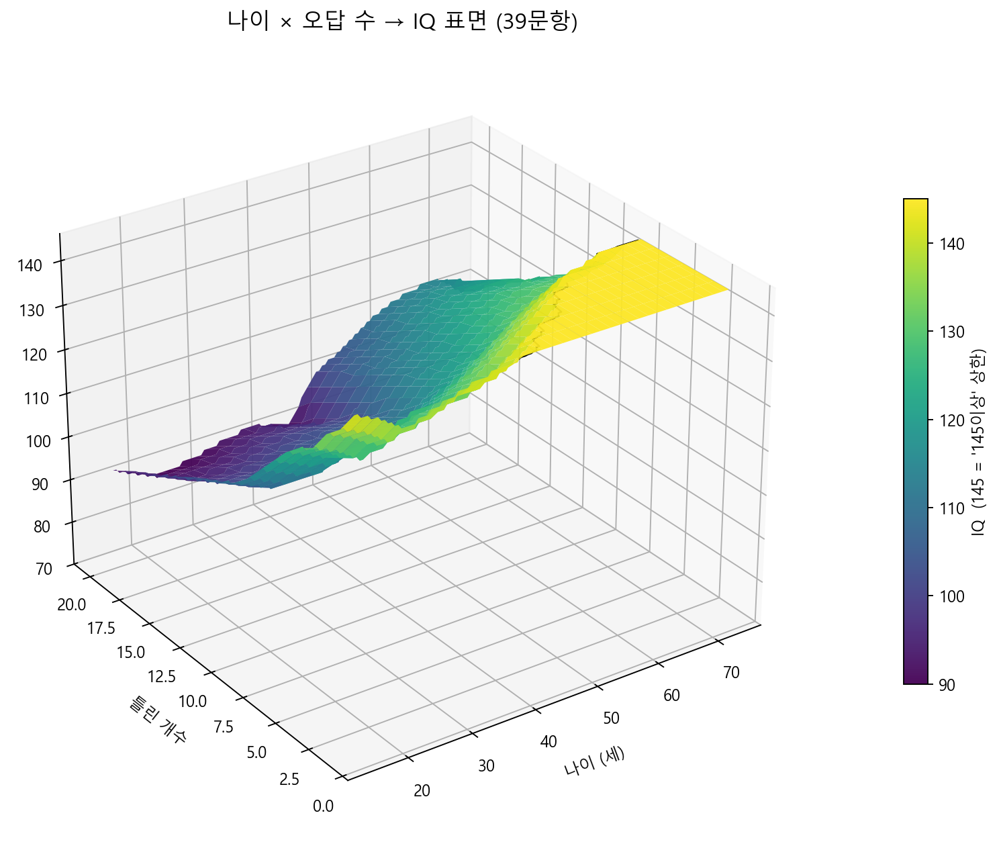
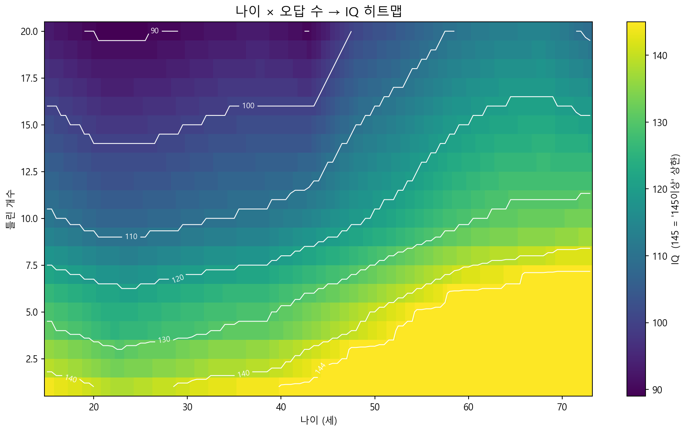
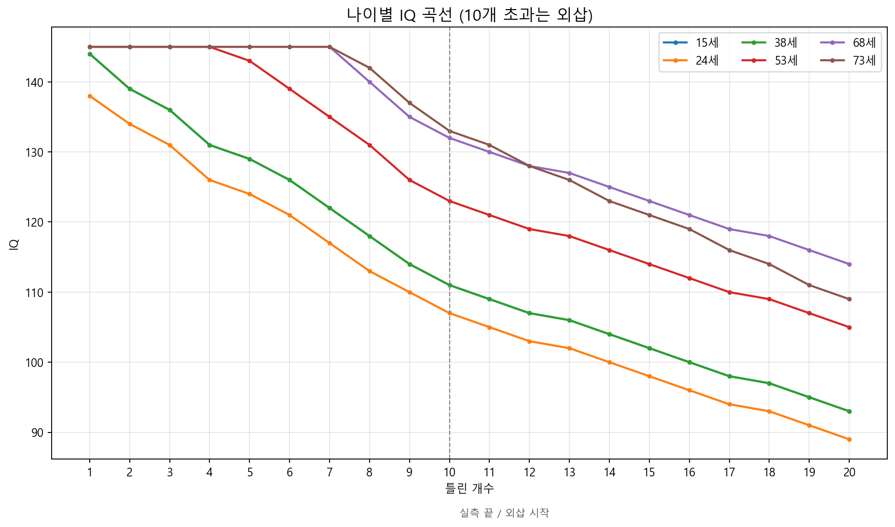

# 멘사 도형테스트 IQ → 오답 수 예측기

나이와 IQ를 입력하면 **39문항 중 몇 개를 틀렸는지** 역산하는 도구입니다.

- 저장소: https://github.com/aoharu11/iq-predictor
- 웹사이트: https://aoharu11.github.io/iq-predictor/

> 이 문서는 단순 사용법이 아니라, **예측 모델의 수학적 정의와 작동 원리**를 정리한 문서입니다.

---

## 목차

1. [무엇을 하는가](#1-무엇을-하는가)
2. [데이터](#2-데이터)
3. [수학적 모델](#3-수학적-모델)
4. [저IQ 외삽 보정](#4-저iq-외삽-보정)
5. [역함수: 오답 개수 예측](#5-역함수-오답-개수-예측)
6. [그래프](#6-그래프)
7. [검증 결과](#7-검증-결과)
8. [커버리지와 한계](#8-커버리지와-한계)
9. [사용법](#9-사용법)
10. [데이터 갱신과 배포](#10-데이터-갱신과-배포)
11. [파일 구조](#11-파일-구조)
12. [고지](#12-고지)

---

## 1. 무엇을 하는가

입력은 두 개입니다.

- 나이 $A$ (만 나이)
- 사이트에 표시된 IQ $T$ (정수 또는 `145이상`)

출력은 다음과 같습니다.

- 틀린 개수 $W$
- 맞은 개수 $N-W$ (단, $N=39$)
- 정답률 $(N-W)/N \times 100\%$

예시:

| 나이 | 표시 IQ | 결과 |
|---:|---:|---|
| 24세 | 138 | 1개 틀림 |
| 24세 | 98 | 15개 틀림 |
| 40세 | 145이상 | 0~1개 허용 |
| 60세 | 142 | 7개 틀림 |
| 73세 | 133 | 10개 틀림 |

---

## 2. 데이터

모델은 **실측 앵커(anchor)** 들로 구성됩니다. 앵커란 실제로 관측한 `(나이, 틀린 개수) → IQ` 점입니다.

| 데이터 | 내용 | 칸 수 |
|---|---|---:|
| 기준표 | 14개 나이 × 11개 오답 (0~10) | 154 |
| 보정표 | 중간 나이 14개의 일부 오답 | 39 |
| 추가검증 | 16세 1개, 44세 2개, 24세 15개 | 3 |
| **합계** | | **196** |

- 기준표 나이: `15, 18, 21, 24, 28, 33, 38, 43, 48, 53, 58, 63, 68, 73`
- 보정표 나이: `22, 23, 25, 26, 27, 30, 35, 40, 45, 50, 55, 60, 65, 70`
- 추가검증 나이: `16, 44` (+ 24세 저IQ 1칸)

즉 **15~73세 59개 나이 중 30개 나이**에 실측이 있고, 나머지 29개 나이는 보간으로 채웁니다.

---

## 3. 수학적 모델

### 3.1 기호

| 기호 | 의미 |
|---|---|
| $A$ | 나이 |
| $W$ | 틀린 개수, $0 \le W \le 39$ |
| $T$ | 사이트 표시 IQ |
| $N$ | 문항 수, $N=39$ |
| $\mathrm{CEIL}$ | 문자열 `145이상` |
| $k$ | 저IQ 외삽 배율, $k=0.60$ |

### 3.2 앵커

오답 개수 $W$ 마다 관측된 숫자 IQ 앵커 집합을 정의합니다.

$$
\mathcal{A}_W=\{(a_i,y_i)\}_{i=1}^{n_W}
$$

- $a_i$: 나이
- $y_i$: 그 나이에서 $W$개 틀렸을 때의 실제 IQ

`145이상`으로 관측된 나이 집합은 따로 둡니다.

$$
\mathcal{C}_W=\{a:\ \text{observed value at } a \text{ is CEIL}\}
$$

천장이 시작되는 가장 이른 나이는 다음과 같습니다.

$$
a_W^{\mathrm{ceil}}=\min\mathcal{C}_W
$$

### 3.3 나이 방향 선형 보간

같은 오답 개수 $W$ 안에서, 나이에 대해 **구간별 선형 보간**을 합니다.

$a_i \le A \le a_{i+1}$ 이면:

$$
v(A,W)=y_i+(y_{i+1}-y_i)\frac{A-a_i}{a_{i+1}-a_i}
$$

- $A$가 첫 앵커보다 작거나 마지막 앵커보다 크면, 가까운 두 점으로 **선형 외삽**합니다.
- 앵커가 하나뿐이면 상수입니다.
- 앵커가 없으면 $v$는 정의되지 않습니다.

이 $v(A,W)$가 모델의 뼈대입니다.

### 3.4 전방 함수: (나이, 오답) → IQ

$$
v(A,W)=
\begin{cases}
\mathrm{Interp}_A(\mathcal{A}_W), & 1\le W\le 10,\\
v(A,10)+k\bigl[v(A,10)-v(A,9)\bigr](W-10), & W>10.
\end{cases}
$$

$$
\widehat{\mathrm{IQ}}(A,W)=
\begin{cases}
\mathrm{CEIL}, & W=0,\\
\mathrm{CEIL}, & 1\le W\le 10 \ \text{and}\ A\ge a_W^{\mathrm{ceil}},\\
\mathrm{CEIL}, & v(A,W)\ge 144.5,\\
\left\lfloor v(A,W)+\tfrac12\right\rfloor, & \text{otherwise}.
\end{cases}
$$

- $W=0$은 항상 `145이상`입니다.
- $W\le 10$에서는 관측된 천장 나이 $a_W^{\mathrm{ceil}}$를 넘으면 `145이상`입니다.
- 보간값이 $144.5$ 이상이면 반올림 전에 `145이상`으로 처리합니다.
- 그 외에는 $\lfloor v+0.5\rfloor$로 정수화합니다.

### 3.5 왜 단일 방정식이 아닌가

이 모델은 $y=ax+b$ 같은 **한 줄짜리 방정식이 아닙니다.**

이유는 관측 데이터 자체가 매끄러운 곡선이 아니기 때문입니다. 예를 들어 1개 오답의 IQ는:

| 나이 | 21세 | 22세 | 23세 | 24세 |
|---|---:|---:|---:|---:|
| 1개 오답 IQ | 139 | 138 | 138 | 138 |

21→24세로 가면서 139 → 138 → 138 → 138로 **단조롭지도, 선형이지도 않습니다.** 그래서 나이별로 따로 보간하고, 천장은 조건문으로 자르는 **구간별 조건 함수(piecewise clamped function)** 가 필요합니다.

---

## 4. 저IQ 외삽 보정

오답 11개 이상은 실측이 거의 없습니다. 그래서 9→10개 구간의 기울기를 그대로 늘리면 과대추정됩니다.

24세 실측:

$$
v(24,9)=110,\qquad v(24,10)=107,\qquad v(24,15)=98
$$

9→10 구간의 기울기는 $-3$입니다. 하지만 실제 10→15 구간의 평균 기울기는:

$$
\frac{98-107}{15-10}=-1.8
$$

따라서 배율 $k$는:

$$
k=\frac{98-107}{(107-110)(15-10)}
=\frac{-9}{-15}
=0.60
$$

즉 저IQ 구간은 9→10 기울기의 **60%만** 적용합니다.

$$
v(A,W)=v(A,10)+0.60\bigl[v(A,10)-v(A,9)\bigr](W-10)
$$

이 보정으로 `24세 15개 → 98`이 정확히 재현됩니다.

---

## 5. 역함수: 오답 개수 예측

### 5.1 입력이 `145이상`일 때

`145이상`은 하나의 숫자가 아니라 **구간**입니다.

$$
W_{\max}=\max\{W:\widehat{\mathrm{IQ}}(A,w)=\mathrm{CEIL}\ \text{for all }0\le w\le W\}
$$

결과는 $0 \sim W_{\max}$개입니다.

예: 45세는 $W_{\max}=2$이므로 `0~2개`.

### 5.2 입력이 숫자 $T$일 때

같은 IQ를 내는 오답 개수를 모두 찾습니다.

$$
\mathcal{E}(A,T)=\{W:\widehat{\mathrm{IQ}}(A,W)=T\}
$$

- $\mathcal{E}$가 비어 있지 않으면 $[\min\mathcal{E},\ \max\mathcal{E}]$를 반환합니다.
- 비어 있으면 가장 가까운 값을 반환합니다.

$$
W^\star=\arg\min_{0\le W<39}\left|\widehat{\mathrm{IQ}}(A,W)-T\right|
$$

이때는 결과에 `근사값`으로 표시됩니다.

---

## 6. 그래프

### 6.1 3차원 IQ 표면



- $x$축: 나이
- $y$축: 틀린 개수
- $z$축: IQ
- 평평한 상단면은 `145이상`을 145로 **표시상 상한 처리**한 것입니다.

### 6.2 히트맵



같은 데이터를 위에서 본 그림입니다. 흰색 등고선은 IQ 90, 100, 110, 120, 130, 140, 144.5입니다.

### 6.3 나이별 IQ 곡선



- 점선($W=10$) 오른쪽은 **실측이 아니라 외삽**입니다.
- 나이가 많을수록 같은 오답 개수에서 IQ가 높게 나옵니다.
- 10개를 넘어가면 기울기가 완만해지는 것을 볼 수 있습니다.

---

## 7. 검증 결과

| 데이터 | 칸 수 | 일치 |
|---|---:|---:|
| 기준표 | 154 | 154/154 |
| 보정표 | 39 | 39/39 |
| 추가검증 | 3 | 3/3 |
| **합계** | **196** | **196/196** |

### 이 100%가 의미하는 것

**앵커로 넣은 196칸을 다시 계산하면 정확히 맞는다**는 뜻입니다. 보간 함수는 정의상 앵커를 지나가므로, 이는 당연한 결과이기도 합니다.

**의미하지 않는 것:**

- 15~73세의 모든 나이를 사이트와 똑같이 맞힌다는 뜻이 아닙니다.
- 오답 11~20개를 정확히 맞힌다는 뜻이 아닙니다.
- 사이트의 실제 서버 로직을 복원했다는 뜻이 아닙니다.

앵커 사이는 **보간**, 앵커 밖은 **외삽**입니다.

---

## 8. 커버리지와 한계

| 구간 | 상태 |
|---|---|
| 나이 15~73, 오답 0~10 | 30개 나이 실측 + 29개 나이 보간 |
| 나이 15~73, 오답 11~20 | 24세 15개 1칸만 실측, 나머지 외삽 |
| 나이 15 미만 / 73 초과 | 전부 외삽 |
| `145이상` | 정확한 오답 개수를 알 수 없어 범위로 반환 |

### 알려진 한계

1. **`145이상`은 원리적으로 범위입니다.** 사이트가 IQ를 145에서 자르기 때문에, 0개인지 3개인지 구분할 수 없습니다.
2. **저IQ 구간은 실측이 1칸뿐입니다.** 24세 15개 = 98만 확인했습니다.
3. **나이 곡선은 단조롭지 않습니다.** 보간이 실제 계단식 표와 어긋날 수 있습니다.
4. **공식 서비스가 아닙니다.** 사이트의 실제 계산과 다를 수 있습니다.

---

## 9. 사용법

### 웹사이트

1. 나이를 입력합니다.
2. 사이트에서 나온 IQ를 입력합니다. (`138` 또는 `145이상`)
3. `계산하기`를 누릅니다.

모든 계산은 브라우저에서 이루어지며, 입력값은 서버로 전송되지 않습니다.

### 배치파일

```
멘사_IQ_오답예측기.bat
```

같은 모델을 Python으로 실행합니다. 실행하면 기준표/보정표/추가검증 자동 검증 결과가 먼저 표시됩니다.

---

## 10. 데이터 갱신과 배포

### 데이터 갱신

```bat
python 웹사이트_생성.py
python 그래프_생성.py
```

- `웹사이트_생성.py`: 원본 `.bat`과 CSV에서 데이터를 읽어 `web/index.html` 안에 넣습니다.
- `그래프_생성.py`: 같은 모델로 `web/assets/`의 그래프 3장을 다시 그립니다.

### 배포

```powershell
cd web
git add index.html README.md assets
git commit -m "Update model and docs"
git push
```

GitHub Pages가 켜져 있으면 1~2분 뒤 자동 반영됩니다. (현재 켜져 있으며 위 주소에서 서비스 중입니다.)

---

## 11. 파일 구조

### 저장소 (배포되는 것)

```
index.html                 # 화면 + 모델 + 데이터 (파일 1개)
README.md                  # 이 문서
assets/
  iq_surface_3d.png        # 3D IQ 표면
  iq_heatmap.png           # 2D 히트맵
  iq_curves.png            # 나이별 IQ 곡선
.gitignore
```

### 원본 모델 (로컬)

```
멘사_IQ_오답예측기.bat      # 원본 예측기
iq_matrix_70s_fast.csv     # 기준표 154칸
iq_gap_validation_32.csv   # 보정표 39칸
iq_extra_validation.csv    # 추가검증 3칸
웹사이트_생성.py            # index.html 데이터 주입
그래프_생성.py              # 그래프 생성
web/                       # 배포 폴더
```

---

## 12. 고지

- 이 프로젝트는 **공식 서비스가 아니며**, iqtest.kr과 제휴 관계가 없습니다.
- 수집된 실측 데이터를 바탕으로 한 **개인 연구/교육용 추정 도구**입니다.
- 결과는 사이트의 실제 계산과 다를 수 있습니다.
- 데이터와 모델은 `index.html` 안에 포함되어 있어 누구나 열람할 수 있습니다.

---

## 참고: 모델 요약

**전방 함수 (나이, 오답 → IQ)**

$$
\widehat{\mathrm{IQ}}(A,W)=
\begin{cases}
\mathrm{CEIL}, & W=0\\
\mathrm{CEIL}, & W\le 10,\ A\ge a_W^{\mathrm{ceil}}\\
\mathrm{CEIL}, & v(A,W)\ge 144.5\\
\lfloor v(A,W)+0.5\rfloor, & \text{otherwise}
\end{cases}
$$

**오답별 기준값 (나이 방향 보간 + 저IQ 보정)**

$$
v(A,W)=
\begin{cases}
\mathrm{Interp}_A(\mathcal{A}_W), & W\le 10\\
v(A,10)+0.60\,[v(A,10)-v(A,9)](W-10), & W>10
\end{cases}
$$
